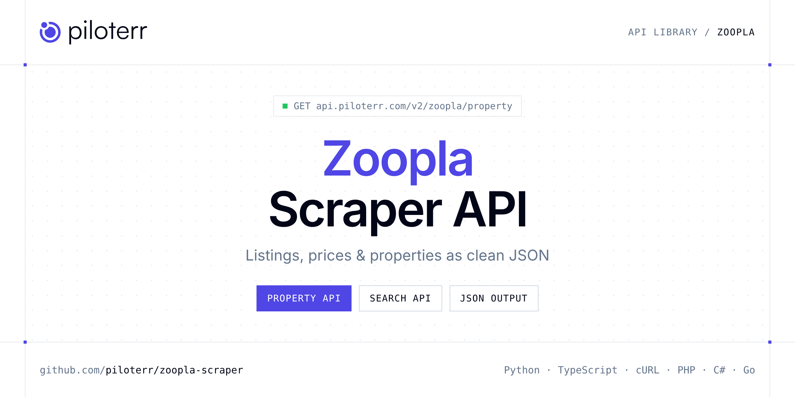

<p align="center">
  <a href="https://www.piloterr.com"></a>
</p>

# Zoopla Scraper API

[](https://discord.gg/CFj3ph8aHU) [](https://app.piloterr.com) [](https://app.piloterr.com/openapi) [](LICENSE)

The **Piloterr Zoopla Scraper API** lets you extract public data from Zoopla as **clean, structured JSON** — no proxies, headless browsers or HTML parsing to maintain. Endpoints available in production:

- **Zoopla Property API** — Extract full property details from a Zoopla listing URL, including price, specs, photo gallery, EPC rating, coordinates, and agent data.
- **Zoopla Search API** — Search Zoopla listings from a search URL and retrieve prices, specs, photos, agency info, and pagination.

Use it for property price monitoring, market analytics, investment sourcing or rental yield models.

| Endpoint | Path | Credits | What you get |
|---|---|---|---|
| [Zoopla Property API](#zoopla-property-api) | `/v2/zoopla/property` | 2 | Extract full property details from a Zoopla listing URL, including price, specs, photo gallery, EPC rating, coordinates, and agent data. |
| [Zoopla Search API](#zoopla-search-api) | `/v2/zoopla/search` | 2 | Search Zoopla listings from a search URL and retrieve prices, specs, photos, agency info, and pagination. |

## Table of contents

- [How it works](#how-it-works)
- [Zoopla Property API](#zoopla-property-api)
- [Zoopla Search API](#zoopla-search-api)
- [Code examples in other languages](#code-examples-in-other-languages)
- [Practical use cases](#practical-use-cases)
- [Why Piloterr?](#why-piloterr)
- [FAQ](#faq)
- [Related scrapers](#related-scrapers)
- [Support](#support)

## How it works

1. **Create a free Piloterr account** and copy your API key from the [dashboard](https://app.piloterr.com).
2. **Send a `GET` (or `POST`) request** to `https://api.piloterr.com/v2/...` with the header `x-api-key: YOUR_API_KEY`.
3. **Receive structured JSON** — Piloterr handles rendering, proxies, retries and parsing.

```bash
export PILOTERR_API_KEY="your-api-key"
pip install requests        # Python
# TypeScript: Node.js 18+ (native fetch), run with `npx tsx file.ts`
```

> Every endpoint accepts both `GET` (query string) and `POST` (JSON body with the same fields).

## Zoopla Property API

Extract full property details from a Zoopla listing URL, including price, specs, photo gallery, EPC rating, coordinates, and agent data.

`GET | POST https://api.piloterr.com/v2/zoopla/property` · **2 credits per request** · [Full reference](https://app.piloterr.com/openapi)

### Request parameters

| Parameter | Type | Required | Description |
|---|---|---|---|
| `query` | string | ✅ | Full Zoopla property detail URL. |

### Python example

```python
import json
import os
import requests

response = requests.get(
    "https://api.piloterr.com/v2/zoopla/property",
    headers={"x-api-key": os.environ["PILOTERR_API_KEY"]},
    params={
        "query": "https://www.zoopla.co.uk/to-rent/details/73119609/",
    },
    timeout=60,
)
response.raise_for_status()
data = response.json()

print(json.dumps(data, indent=2, ensure_ascii=False)[:2000])
```

### TypeScript example

```typescript
type ZooplaProperty = {
  id?: number;
  url?: string;
  agent?: {
    url?: string;
    logo?: string;
    name?: string;
  };
  price?: {
    amount?: number;
    currency?: string;
  };
  title?: string;
  address?: string;
  gallery?: string[];
  epc_rating?: string;
  floor_area?: string;
  coordinates?: {
    latitude?: number;
    longitude?: number;
    google_mape_source?: string;
  };
  property_info?: {
    title?: string;
    value?: string;
  }[];
  property_tags?: string[];
  num_of_bedrooms?: number;
  num_of_bathrooms?: number;
  num_of_receptions?: number;
  property_description?: string[];
};

const params = new URLSearchParams({
  "query": "https://www.zoopla.co.uk/to-rent/details/73119609/",
});

const response = await fetch(`https://api.piloterr.com/v2/zoopla/property?${params}`, {
  headers: { "x-api-key": process.env.PILOTERR_API_KEY! },
});
if (!response.ok) throw new Error(`Piloterr error ${response.status}: ${await response.text()}`);

const data = (await response.json()) as ZooplaProperty;

console.log(JSON.stringify(data, null, 2).slice(0, 2000));
```

<details>
<summary><b>POST variant</b></summary>

```http
POST https://api.piloterr.com/v2/zoopla/property
x-api-key: YOUR_API_KEY
Content-Type: application/json

{"query": "https://www.zoopla.co.uk/to-rent/details/73119609/"}
```
</details>

### Output example

Example response from the API reference, abridged — real values depend on the page you scrape.

```json
{
  "id": 73119609,
  "url": "https://www.zoopla.co.uk/to-rent/details/73119609/",
  "agent": {
    "url": "example",
    "logo": "example",
    "name": "example"
  },
  "price": {
    "amount": 6500,
    "currency": "£"
  },
  "title": "Fontenoy Road, London SW12, 5 bed flat to rent, £6,500 pcm - Zoopla",
  "address": "Fontenoy Road, London SW12",
  "gallery": [
    "https://lid.zoocdn.com/u/1024/768/41b277e206b85594ff9640344cb1d4df52a22048.jpg",
    "https://lid.zoocdn.com/u/1024/768/fa0ef0ead995190d7f854c950ac358fb0272fbd9.jpg"
  ],
  "epc_rating": "EPC Rating: D",
  "floor_area": "2,750 sq ft",
  "coordinates": {
    "latitude": -0.142507,
    "longitude": 51.438041,
    "google_mape_source": "https://maps.prod.zoopla.co.uk/styles/portal/static/-0.142507,51.438041,13/480x160@2x.webp?marker=-0.142507%2C51.438041%7Cmap-static-pin-…"
  },
  "property_info": [
    {
      "title": "Deposit",
      "value": "£7,500"
    },
    {
      "title": "Council tax band",
      "value": "G"
    }
  ],
  "property_tags": [
    "EPC Rating: D"
  ],
  "num_of_bedrooms": 5,
  "num_of_bathrooms": 3,
  "num_of_receptions": 3,
  "property_description": [
    "Family home",
    "Off-street parking"
  ]
}
```

### Response fields

| Field | Type | Description |
|---|---|---|
| `id` | integer |  |
| `url` | string |  |
| `agent` | object |  |
| `agent.url` | string |  |
| `agent.logo` | string |  |
| `agent.name` | string |  |
| `price` | object |  |
| `price.amount` | integer |  |
| `price.currency` | string |  |
| `title` | string |  |
| `address` | string |  |
| `gallery` | string[] |  |
| `epc_rating` | string |  |
| `floor_area` | string |  |
| `coordinates` | object |  |
| `coordinates.latitude` | number |  |
| `coordinates.longitude` | number |  |
| `coordinates.google_mape_source` | string |  |
| `property_info[]` | object[] |  |
| `property_info[].title` | string |  |
| `property_info[].value` | string |  |
| `property_tags` | string[] |  |
| `num_of_bedrooms` | integer |  |
| `num_of_bathrooms` | integer |  |
| `num_of_receptions` | integer |  |

## Zoopla Search API

Search Zoopla listings from a search URL and retrieve prices, specs, photos, agency info, and pagination.

`GET | POST https://api.piloterr.com/v2/zoopla/search` · **2 credits per request** · [Full reference](https://app.piloterr.com/openapi)

### Request parameters

| Parameter | Type | Required | Description |
|---|---|---|---|
| `query` | string | ✅ | Full Zoopla search results URL. |

### Python example

```python
import json
import os
import requests

response = requests.get(
    "https://api.piloterr.com/v2/zoopla/search",
    headers={"x-api-key": os.environ["PILOTERR_API_KEY"]},
    params={
        "query": "https://www.zoopla.co.uk/for-sale/property/manchester/",
    },
    timeout=60,
)
response.raise_for_status()
data = response.json()

print(json.dumps(data, indent=2, ensure_ascii=False)[:2000])
```

### TypeScript example

```typescript
type ZooplaSearch = {
  results?: {
    url?: string;
    image?: string;
    price?: number;
    agency?: string;
    address?: string;
    square_ft?: number;
    just_added?: boolean;
    description?: string;
    num_bedrooms?: number;
    num_bathrooms?: number;
    price_currency?: string;
    num_living_room?: unknown;
  }[];
  pagination?: {
    next?: number;
    current?: number;
    other_pages?: unknown[];
    total_pages?: number;
    has_next_page?: boolean;
    total_results?: number;
  };
};

const params = new URLSearchParams({
  "query": "https://www.zoopla.co.uk/for-sale/property/manchester/",
});

const response = await fetch(`https://api.piloterr.com/v2/zoopla/search?${params}`, {
  headers: { "x-api-key": process.env.PILOTERR_API_KEY! },
});
if (!response.ok) throw new Error(`Piloterr error ${response.status}: ${await response.text()}`);

const data = (await response.json()) as ZooplaSearch;

console.log(JSON.stringify(data, null, 2).slice(0, 2000));
```

<details>
<summary><b>POST variant</b></summary>

```http
POST https://api.piloterr.com/v2/zoopla/search
x-api-key: YOUR_API_KEY
Content-Type: application/json

{"query": "https://www.zoopla.co.uk/for-sale/property/manchester/"}
```
</details>

### Output example

Example response from the API reference, abridged — real values depend on the page you scrape.

```json
{
  "results": [
    {
      "url": "https://www.zoopla.co.uk/new-homes/details/71832056/",
      "image": "https://lid.zoocdn.com/645/430/47fabc16bd9d4a08bf75ae1d2097af505b5914f0.jpg",
      "price": 132300,
      "agency": "Latimer Homes - Islington Wharf",
      "address": "Old Mill Street, Manchester M4",
      "square_ft": 883,
      "just_added": false,
      "description": "Price shown is 35% share of £378,000 full market value.",
      "num_bedrooms": 2,
      "num_bathrooms": 2,
      "price_currency": "Sterling pound £",
      "num_living_room": null
    },
    {
      "url": "https://www.zoopla.co.uk/new-homes/details/72441029/",
      "image": "https://lid.zoocdn.com/645/430/bdc475a4ce5f4d81dd023d14bf099df1155117bd.jpg",
      "price": 87000,
      "agency": "L&Q - Victoria Riverside",
      "address": "Dantzic Street, Manchester M4",
      "square_ft": null,
      "just_added": false,
      "description": "Reserve a 1 or 2 bedroom apartment between 1 – 30 June with a £99 reservation fee and unlock better interest rates with a ...",
      "num_bedrooms": 2,
      "num_bathrooms": 2,
      "price_currency": "Sterling pound £",
      "num_living_room": null
    }
  ],
  "pagination": {
    "next": 2,
    "current": 1,
    "other_pages": [],
    "total_pages": 12,
    "has_next_page": true,
    "total_results": 296
  }
}
```

### Response fields

| Field | Type | Description |
|---|---|---|
| `results[]` | object[] |  |
| `results[].url` | string |  |
| `results[].image` | string |  |
| `results[].price` | integer |  |
| `results[].agency` | string |  |
| `results[].address` | string |  |
| `results[].square_ft` | integer |  |
| `results[].just_added` | boolean |  |
| `results[].description` | string |  |
| `results[].num_bedrooms` | integer |  |
| `results[].num_bathrooms` | integer |  |
| `results[].price_currency` | string |  |
| `results[].num_living_room` | object |  |
| `pagination` | object |  |
| `pagination.next` | integer |  |
| `pagination.current` | integer |  |
| `pagination.other_pages` | any[] |  |
| `pagination.total_pages` | integer |  |
| `pagination.has_next_page` | boolean |  |
| `pagination.total_results` | integer |  |

## Code examples in other languages

Ready-to-run examples live in the [`examples/`](examples) folder. Each one reads your key from the `PILOTERR_API_KEY` environment variable.

| Language | Property | Search |
|---|---|---|
| cURL (Bash) | [`property`](examples/curl/property.sh) | [`search`](examples/curl/search.sh) |
| PHP | [`property`](examples/php/property.php) | [`search`](examples/php/search.php) |
| C# | [`property`](examples/csharp/Property.cs) | [`search`](examples/csharp/Search.cs) |
| Go | [`property`](examples/go/property.go) | [`search`](examples/go/search.go) |
| Java | [`property`](examples/java/PropertyExample.java) | [`search`](examples/java/SearchExample.java) |
| Ruby | [`property`](examples/ruby/property.rb) | [`search`](examples/ruby/search.rb) |
| Node.js | [`property`](examples/nodejs/property.mjs) | [`search`](examples/nodejs/search.mjs) |

## Practical use cases

- **Price monitoring** — Track asking prices and price drops per area.
- **Market analytics** — Measure inventory, days on market and price per m² / sqft.
- **Investment sourcing** — Detect undervalued properties as soon as they are listed.
- **Rental yield models** — Combine sale and rent listings to estimate yields.
- **Proptech products** — Power portals, valuation tools and alerts with structured listings.

## Why Piloterr?

- **No infrastructure** — no proxies, headless browsers or CAPTCHA solving to run yourself.
- **Structured JSON** — stable, documented fields instead of brittle HTML selectors.
- **Pay per request** — transparent credit cost per endpoint, failed requests are retried for you.
- **One API key, hundreds of sources** — Zoopla plus many other e-commerce, search and company data endpoints in the [Piloterr library](https://www.piloterr.com/library).
- **Any language** — plain HTTPS + JSON, with examples for Python, TypeScript, cURL, PHP, C#, Go, Java, Ruby and Node.js.

## FAQ

### Is it legal to scrape Zoopla?

Collecting publicly available data is generally allowed in many jurisdictions, but rules depend on your country, the data you collect and how you use it. Avoid personal data unless you have a lawful basis, respect the website's terms where they apply, and get legal advice for your specific use case. This is not legal advice.

### Do I need proxies or a headless browser?

No. Piloterr handles rendering, proxy rotation and retries on its side. You only send an HTTPS request with your `x-api-key` header and receive JSON.

### How much does a request cost?

Credits per call: `/v2/zoopla/property` **2**, `/v2/zoopla/search` **2**. See the [Piloterr website](https://www.piloterr.com) for plans.

### What data does the Zoopla API return?

Each endpoint returns structured JSON: **Zoopla Property** — `id`, `url`, `agent`, `agent.url`, `agent.logo`, `agent.name`; **Zoopla Search** — `results[]`, `results[].url`, `results[].image`, `results[].price`, `results[].agency`, `results[].address`.

### Which languages are supported?

Any language that can make an HTTP request. This README shows Python and TypeScript; the [`examples/`](examples) folder contains cURL, PHP, C#, Go, Java, Ruby and Node.js.

## Related scrapers

- [Apartments Scraper API](https://github.com/piloterr/apartments-scraper)
- [Argenprop Scraper API](https://github.com/piloterr/argenprop-scraper)
- [Centris Scraper API](https://github.com/piloterr/centris-scraper)
- [Fotocasa Scraper API](https://github.com/piloterr/fotocasa-scraper)
- [Funda Scraper API](https://github.com/piloterr/funda-scraper)
- [Homestra Scraper API](https://github.com/piloterr/homestra-scraper)
- [All Piloterr scrapers on GitHub](https://github.com/piloterr)

## Support

- 💬 Join the [Piloterr Discord](https://discord.gg/CFj3ph8aHU) to ask questions and share what you build.
- 📚 Browse the [API reference (OpenAPI)](https://app.piloterr.com/openapi) and the [Piloterr library](https://www.piloterr.com/library).
- 🔑 [Get your API key](https://app.piloterr.com).

---

<p align="center">
  <a href="https://www.piloterr.com">
    <picture>
      <source media="(prefers-color-scheme: dark)" srcset="images/logo-dark.svg">
      
    </picture>
  </a>
  <br>
  <sub>Built by <a href="https://www.piloterr.com">Piloterr</a> — web scraping APIs for e-commerce, search, real estate and more, one API key.</sub>
</p>

<sub>Zoopla is a trademark of its respective owner. This repository is not affiliated with or endorsed by Zoopla. Examples are released under the MIT license.</sub>
